# PSNG - breathing-event analysis of polysomnography airflow

Unsupervised analysis of the nasal-airflow channel (`DEBIT`) of overnight polysomnography (PSG) recordings.
The goal is to surface breathing events (apnea, hypopnea, artefacts) without hand labels: one night trains,
a second night validates, and every method is scored side by side against a transparent rule-based event
detector, the hypnogram, a supervised reference and - independently of the airflow - SpO2 desaturations.

Methods in the box: per-window signal preprocessing, respiratory features, PCA / autoencoder reduction,
six clusterers (k-means, mini-batch k-means, bisecting k-means, Gaussian mixture, DBSCAN, isolation forest),
rule-based event detection with a rolling-median or Kalman baseline, a hidden Markov model (HMM) event detector,
SpO2 desaturation scoring, t-SNE visualisation, and XGBoost as a supervised ceiling. Everything is fitted on night 1 only and applied unchanged to night 2 (no leakage).

## In plain words

**The problem.** During a sleep study a small sensor under the nose records every breath all night. Some people
repeatedly stop breathing (an **apnea**) or breathe very shallowly (a **hypopnea**) for 10 seconds or more. Each
time, oxygen in the blood drops and sleep is disturbed. Doctors count these events per hour of sleep, the
**AHI**: under 5 is normal, 5-15 mild, 15-30 moderate, above 30 severe sleep apnea. Scoring a night by hand takes
an expert hours; this project finds the events automatically.

**The data.** One patient, two full nights (about 9 hours each). Night 1 is used to learn; night 2 is kept unseen
and only used to check that what was learned still works.

**The methods, in one line each.**

| method | what it does | needs labels? |
|---|---|---|
| threshold rules | flags breathing below 70 % of its normal level for 10 s or more (the clinical definition) | no |
| grouping (clustering, e.g. k-means) | sorts 30 s pieces of the night into groups of similar breathing; one group turns out to be "events" | no |
| hidden Markov model (HMM) | learns breathing states (reduced / normal / large breaths) and how long each lasts, second by second | no |
| XGBoost | a supervised model taught by the rules on night 1 | yes (the rules' labels) |
| blood-oxygen check | tests every method against a second sensor: does oxygen dip after each event? | - |

**What we found.**

* The detected events are real: after an event, blood oxygen dips **3-4 times more often than by chance**.
* The patient has **moderate** sleep apnea by airflow (AHI 15-19); counting only events confirmed by an oxygen dip
  gives 11-15 (mild to borderline moderate).
* Unsupervised grouping finds events almost as well as a supervised model (k-means 0.71 vs XGBoost 0.73 agreement
  on the unseen night); the HMM does as well without any grouping and beats the fixed rules against oxygen.
* Many oxygen dips have no flow event; that is the gap a better detector can still close.

**Words used below.**

| term | meaning |
|---|---|
| airflow / breathing strength | size of each breath from the nasal sensor; 1 = this person's typical breath |
| SpO2 | share of the blood's oxygen carriers that are loaded with oxygen, measured at the finger (normally 94-98 %) |
| desaturation / oxygen dip | SpO2 falling 3 % or more below its recent level |
| sleep stages | awake, drowsy (N1), light sleep (N2), deep sleep (N3) and dream sleep (REM), scored every 30 s by an expert |
| F1 | agreement score from 0 (none) to 1 (perfect) that balances missed events and false alarms |
| training / validation | night 1 (learn) / night 2 (check on unseen data) |

## Results at a glance (patient 8, night 1 -> night 2, whole nights)

| | night 1 (training) | night 2 (validation) |
|---|---|---|
| recording / sleep hours | 9.42 / 5.14 | 9.05 / 4.51 |
| rule-based apneas / hypopneas | 2 / 123 | 21 / 157 |
| events per hour of recording / **AHI** (per hour of sleep) | 13.3 / **14.6** | 19.7 / **19.3** |
| best clusterer (k-means, cluster "hypopnea"): event F1 | 0.580 | **0.707** |
| supervised XGBoost on the same features: event F1 / AUC | 0.903 (fit) | 0.731 / 0.937 |
| SpO2: desaturations per hour of sleep (ODI, >= 3 %) | 30.1 | 27.1 |
| SpO2: rule-based events followed by a desaturation | 75 % (chance 22 %) | 70 % (chance 18 %) |
| **AHI with desaturation-confirmed hypopneas** (AASM 1A, no arousals) | **11.1** | **14.6** |
| HMM detector (no clustering, no labels): AHI / events confirmed by SpO2 | 22.8 / 68 % | 23.5 / 70 % |
| best detector against SpO2 (F1 of confirmed share and desaturations explained) | rules, Kalman: 0.650 | **XGBoost: 0.730**, k-means 0.662, HMM 0.644 |

The unsupervised k-means "hypopnea" cluster recovers event windows at F1 0.71 on the unseen night, close to
the 0.73 that a supervised model trained on the detector's labels reaches: the features carry the event
information and the clusters transfer across nights. Both nights land in the moderate sleep-apnea range
(AHI 15-30) by the flow-only rules; requiring a desaturation for hypopneas puts them at 11 and 15 (mild to
borderline moderate).

The SpO2 check is the only reference that does not come from the airflow, so it is the one that can say whether
the events are real: every detector's events are followed by a desaturation **3.1-3.9 times more often than
chance**. See [SpO2 desaturations](#spo2-desaturations-an-airflow-independent-check-psngoximetrypy).

The HMM is the non-clustering detector: it learns three breathing states from night 1 and how long each one
lasts, then decodes night 2. It beats the threshold rules against SpO2 on both nights (F1 0.601 vs 0.504 and
0.644 vs 0.567), matches k-means against the rule labels on night 2 (0.714 vs 0.707), and needs no features,
windows or labels. See [Hidden Markov model](#hidden-markov-model-event-detector-psnghmmpy).

Each night at a glance - breathing strength, events per 10 minutes, blood oxygen and sleep stage on one time axis:


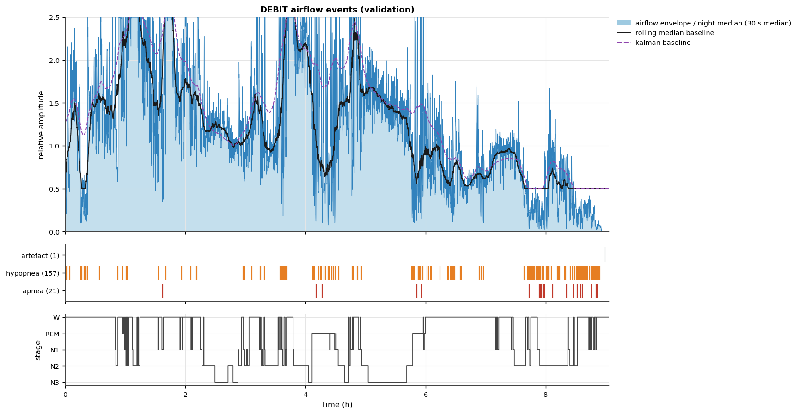

## Every algorithm on one card

Every method gets the same card, so they can be compared side by side:

* **Top** - the same 10 minutes of night 2 (unseen), breathing strength, and the method's decision as a coloured band underneath.
* **Middle** - the events the method finds next to those of the threshold rules.
* **Bottom left** - what each of the method's groups or states looks like, drawn over how strong breathing was (all seconds of night 1, grey). Left of the dotted line is the 70 % event line.
* **Bottom right** - a table that explains the method: what each group contains, how states follow each other, or how well it agrees with the rules.

Each card has an **examples** sheet with real snippets of the airflow: grey shading is the method's own window or
event, orange / red is what the rules found. For the HMM and XGBoost the rows show where they agree with the rules,
where only the method finds an event, where only the rules do, and normal breathing.

### Threshold rules (the reference)

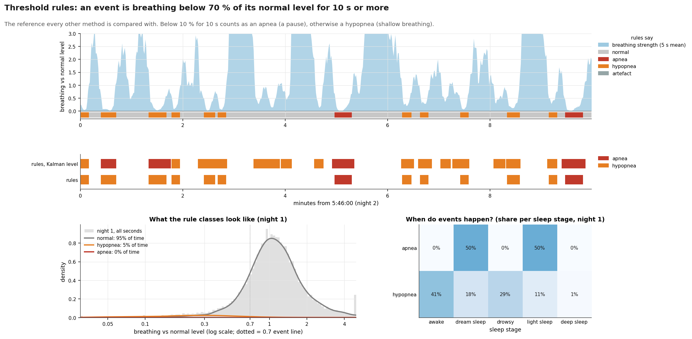
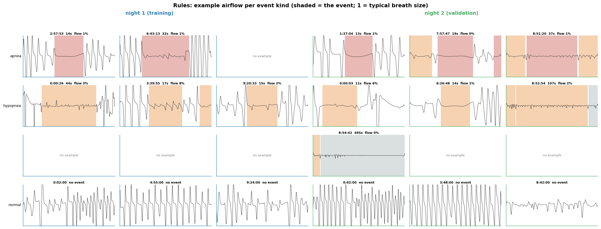

### k-means grouping (best unsupervised grouping)

Every group gets a name from what it contains, and night 2 reuses the names of night 1:

| k-means group | windows night 1 / 2 | event share night 1 / 2 |
|---|---|---|
| 0: regular breathing | 355 / 396 | 1 % / 2 % |
| 1: irregular rhythm | 119 / 119 | 15 % / 16 % |
| 2: regular breathing #2 | 324 / 101 | 12 % / 16 % |
| **3: hypopnea** | 129 / 214 | **60 % / 68 %** |
| 4: large breaths, mostly W | 203 / 255 | 1 % / 4 % |

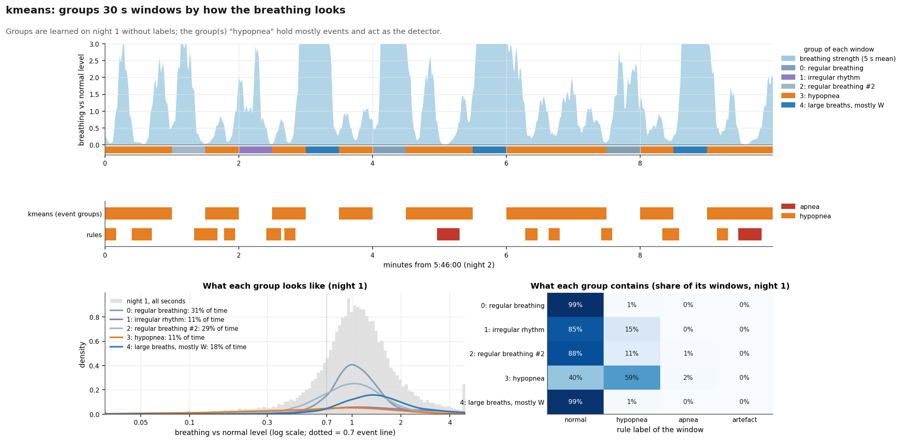


The other grouping methods have the same card, examples and timelines in `docs/figures/`:
[mini-batch](docs/figures/minibatch_card.png), [bisecting](docs/figures/bisecting_card.png),
[Gaussian mixture](docs/figures/gmm_card.png), [DBSCAN](docs/figures/dbscan_card.png),
[isolation forest](docs/figures/isolation_card.png).


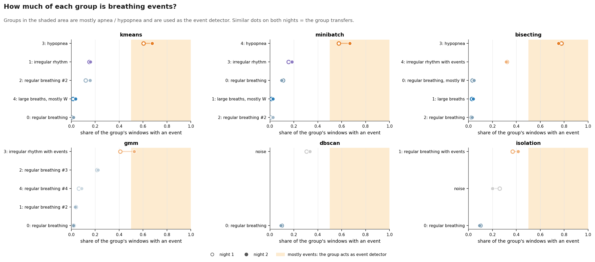


### Hidden Markov model (no grouping, learns states and their durations)

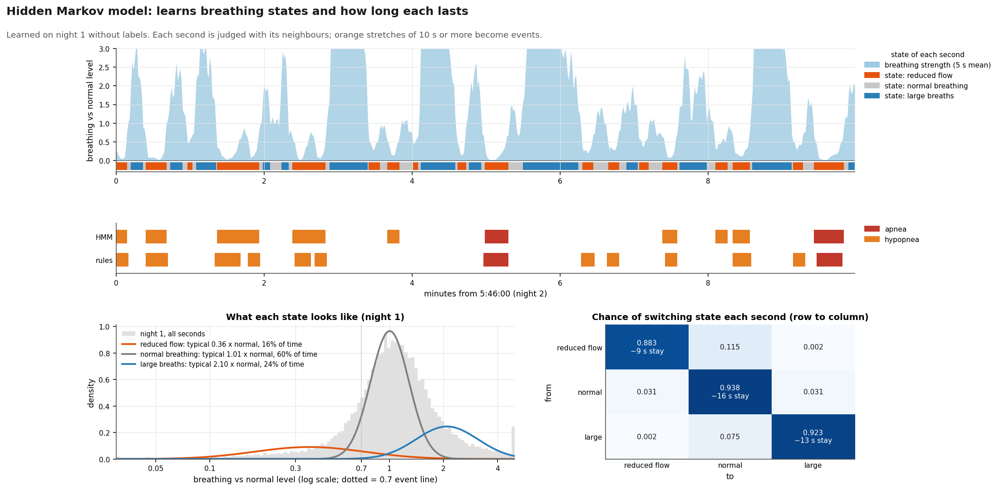
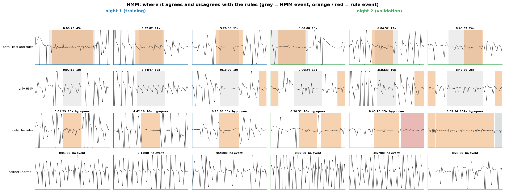

### XGBoost (supervised reference)

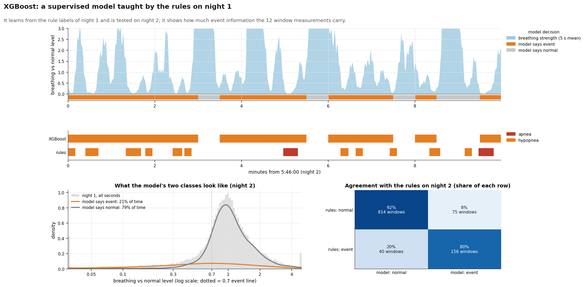
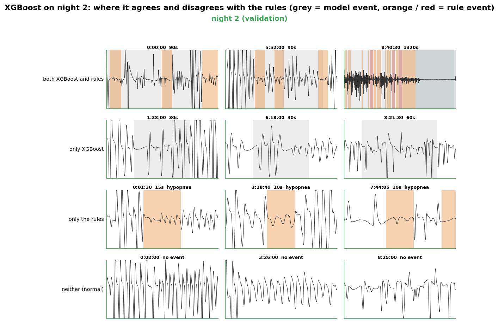

## Pipeline

```
EDF ─┬─► DEBIT airflow ──► 1 Hz envelope ──► local baseline ──┬─► threshold rules ──────► events ─┐
     │                                                        └─► HMM (fitted night 1) ─► events ─┤
     │                                                                                            ▼
     ├─► SAT (SpO2) ──► 1 Hz, probe-off removed ──► >= 3 % desaturations ──► confirm events, ODI, AHI, score every detector
     │
     └─► DEBIT 30 s windows ──► smooth · detrend · 0.1-2 Hz band-pass · de-spike · scale by baseline
                 ▼
           respiratory features (cached, resumable) ──► z-score ──► select ──► reduce (PCA | autoencoder | none)
                 ▼                                                  all fitted on night 1 only, persisted
           clusterers (fitted on night 1) ──► predict night 2 ──► names · profiles · metrics · plots · report
                 ▲
           rule event labels and hypnogram (30 s epochs) label every window
```

Training fits the transformer and the models and names the clusters; validation loads them and only
*applies* them, so validation scores are honest.

## Methods

### Pre-processing (per 30 s window, `psng/windows.py`)

1. **NaN interpolation** - gaps are linearly interpolated.
2. **Smoothing** - 0.5 s moving average removes sensor noise.
3. **Detrend** - a linear trend (DC drift of the flow sensor) is removed.
4. **Band-pass 0.1-2 Hz** - the respiratory band (6-120 breaths/min), 3rd-order Butterworth applied forwards and backwards (zero phase).
5. **De-spike** - 100 ms median filter removes short spikes.
6. **Scaling** - `normalisation: recording` divides by the night's median envelope amplitude, so 1.0 = typical breath and an apnea stays small. `window` z-scores each window on its own (shape only); it was the original behaviour and cannot see amplitude drops, which is why it was replaced.

Filters are designed once per run, not once per window; windows are processed in parallel and the features are
checkpointed in chunks so an interrupted run resumes.

### Features (`psng/features/`)

`respiratory` (default, 12 features per window; the envelope is the RMS per second):

| feature | meaning |
|---|---|
| `amplitude` | median envelope (1.0 = typical breathing of the night) |
| `envelope_min`, `envelope_max`, `envelope_cv` | lowest / highest second and coefficient of variation of the envelope |
| `low_flow_fraction` | share of seconds with flow below 70 % of baseline |
| `apnea_fraction` | share of seconds with flow below 10 % of baseline |
| `longest_low_flow_seconds` | longest run of low flow (the single most informative feature) |
| `breathing_rate`, `breathing_regularity` | breaths per minute from peak detection and the coefficient of variation of the breath intervals |
| `dominant_frequency`, `spectral_entropy` | spectral peak (Hz) and flatness of the spectrum |
| `complexity` | Hjorth complexity (waveform shape) |

Other extractors kept for comparison: `freqtimepatt` (shape + rhythm only), `basic` (amplitude and peak
statistics), `hjorth`, `wavelet` (db4 coefficient statistics).

### Feature transform (`psng/transform.py`)

* **Scaling** - z-score with the training mean and standard deviation.
* **Selection** - `none`, `correlation` (drop one of each pair above a threshold) or `pca` (keep features with strong loadings).
* **Reduction** - `pca` keeps the directions of largest variance (linear); `autoencoder` is a symmetric MLP
  (12 -> 16 -> 3 -> 16 -> 12, tanh) trained to reconstruct its input, the 3 bottleneck activations are the
  reduced features (non-linear); `none` clusters the 12 scaled features directly.

### Clusterers (`psng/clustering/`)

| model | how it works | result here |
|---|---|---|
| `kmeans` | k centroids, each window joins the nearest; 10 restarts | best event F1, stable names across nights |
| `minibatch` | k-means on random batches; same quality, faster on big data | same as k-means |
| `bisecting` | splits the biggest cluster in two until k | higher precision, lower recall |
| `gmm` | k Gaussians with full covariances, soft membership | overlapping components, weak silhouette |
| `dbscan` | clusters = dense regions, the rest is noise | one blob: the feature space is a continuum, not islands |
| `isolation` | DBSCAN clusters plus an isolation-forest "anomaly" cluster | separates outliers, not events |

Unseen windows are assigned by the fitted model (centroids, mixture, nearest core sample); nothing is re-fitted
on validation data. Number of clusters: `python -m psng sweep` scans k (silhouette prefers 2, event F1 peaks at 5
and 10; 5 keeps the clusters interpretable).

### Rule-based event detection (`psng/events.py`)

On the 1 Hz envelope relative to a **local baseline**: apnea = flow below 10 % for >= 10 s, hypopnea = below
70 % for >= 10 s, artefact = low flow for more than 120 s (sensor off). These follow the AASM flow criteria but
cannot check desaturation or arousal, so they are a reference for the clusters, not a diagnosis. The baseline
is either a centred **10-minute rolling median** or a **Kalman smoother** (local-level model, forward filter +
backward RTS pass, `psng/kalman.py`); the Kalman level is slower to follow amplitude drops, so it flags about
50 % more events (see the table below). AHI = apneas + hypopneas starting in sleep per hour of sleep, using the
hypnogram.

### SpO2 desaturations: an airflow-independent check (`psng/oximetry.py`)

**What SpO2 is.** SpO2 is the share of haemoglobin in arterial blood that is carrying oxygen, measured at the
finger. A healthy sleeper stays around 94-98 %. When breathing stops or shrinks, less oxygen reaches the lungs and,
once that blood has travelled to the finger, SpO2 falls a few percent; when breathing resumes it climbs back.
Every other reference here comes from the airflow sensor itself, so SpO2 is the one check the airflow methods
cannot simply agree with themselves on.

$$\mathrm{SpO_2} = \frac{\mathrm{HbO_2}}{\mathrm{HbO_2} + \mathrm{Hb}} \times 100\,\%$$

with $\mathrm{HbO_2}$ the oxygen-carrying and $\mathrm{Hb}$ the oxygen-free haemoglobin. The pulse oximeter shines
red (660 nm) and infrared (940 nm) light through the finger; the two forms absorb them differently. It divides the
pulsing part of each signal (AC, arterial blood) by the steady part (DC, tissue) and takes the ratio

$$R = \frac{AC_{\mathrm{red}} / DC_{\mathrm{red}}}{AC_{\mathrm{IR}} / DC_{\mathrm{IR}}}, \qquad \mathrm{SpO_2} \approx a - b\,R$$

where $a$ and $b$ come from the manufacturer's calibration (a common textbook form is $110 - 25R$). The device does
this; the EDF channel `SAT` already holds SpO2 in %, in 1 % steps.

**How a desaturation is found.** Let $x_i$ be the raw `SAT` samples (256 Hz) and $n$ count seconds.

1. *One value per second*, with probe-off dropouts (the sensor writes 0.5) removed; gaps up to 10 s are filled by linear interpolation:
   $$s_n = \mathrm{median}\lbrace x_i : i \in \text{second } n\rbrace, \qquad s_n := \text{missing if } s_n \notin [50, 100]$$
2. *Remove 1 % flicker* with a 3-second median: $\tilde s_n = \mathrm{median}(s_{n-1}, s_n, s_{n+1})$.
3. *Reference level* - the best saturation of the last $L = 60$ s, and the *drop* below it:
   $$b_n = \max_{n-L < k \le n} \tilde s_k, \qquad d_n = b_n - \tilde s_n$$
4. *Desaturation* - every unbroken stretch of seconds $[a, e)$ with $d_n \ge 3$ % lasting $e - a \ge 3$ s. Its *nadir*
   (lowest point) and *depth* are
   $$\tau = \arg\min_{a \le n < e} \tilde s_n, \qquad \text{depth} = \max_{a \le n < e} d_n$$

Example: SpO2 has been 95 % for a minute, then reads 92, 91, 91, 92 %. The drops are 3, 4, 4, 3 %, so this is one
desaturation of depth 4 % with its nadir at the first 91 % second.

**How events are confirmed and detectors scored.** An airflow event $i$ runs from $t^s_i$ to $t^e_i$. Desaturation
$j$ has nadir $\tau_j$. Blood takes time to travel from the lungs to the finger, so the nadir is allowed up to
$\lambda = 45$ s after the event ends (the measured delay has a median of 18-19 s on both nights, 10th-90th
percentile -6 to 56 s).

$$c_i = \mathbb{1}\left[\exists j : t^s_i \le \tau_j \le t^e_i + \lambda\right] \qquad \text{(event } i \text{ is confirmed)}$$
$$x_j = \mathbb{1}\left[\exists i : t^s_i \le \tau_j \le t^e_i + \lambda\right] \qquad \text{(desaturation } j \text{ is explained)}$$

For a detector with $N$ events and $M$ desaturations, both counted in sleep only:

$$\text{confirmed } P = \frac{1}{N}\sum_i c_i, \qquad \text{explained } R = \frac{1}{M}\sum_j x_j, \qquad F_1 = \frac{2PR}{P + R}$$

A detector that flags many or long events would confirm many by luck, so the same $P$ is recomputed with the
desaturations moved to random times. Each nadir is shifted by the same offset $\delta_k$ and wrapped around the
recording of length $T$ (this keeps their spacing):

$$P_{\text{chance}} = \frac{1}{K}\sum_{k=1}^{K} P\left(\{(\tau_j + \delta_k) \bmod T\}\right), \quad \delta_k \sim \mathcal{U}[600, T - 600]\ \text{s},\ K = 200, \qquad \text{lift} = \frac{P}{P_{\text{chance}}}$$

Night-level numbers, with $H$ the hours of sleep from the hypnogram:

$$\mathrm{ODI} = \frac{\#\,\text{desaturations in sleep}}{H}, \qquad \mathrm{AHI}_{3\%} = \frac{\#\,\text{apneas} + \#\,\text{confirmed hypopneas}}{H}$$

$\mathrm{AHI}_{3\%}$ follows the AASM 1A hypopnea rule (>= 30 % flow drop with a >= 3 % desaturation). Arousals,
the rule's other route, are not checked, so it is a lower bound.

Ten minutes of night 2: each flow reduction (shaded, solid = confirmed) is followed about 20 s later by an SpO2
dip (triangles).

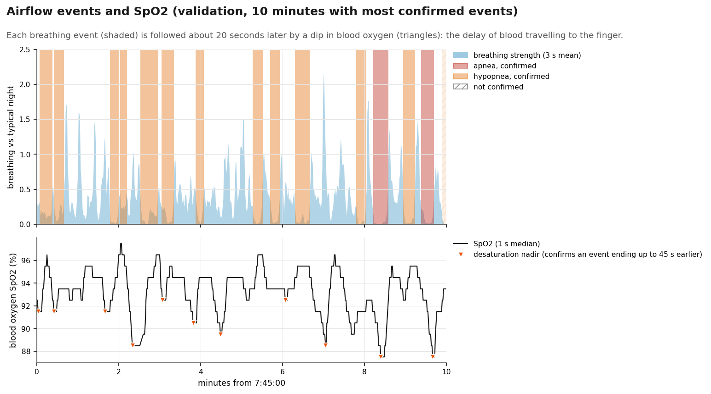

### Hidden Markov model event detector (`psng/hmm.py`)

**Idea.** Breathing moves between a few hidden states (normal, reduced, large recovery breaths). Each state
produces typical flow values, and each state tends to last a while. The HMM learns both from night 1 without labels.
Unlike a clustering of seconds or windows, every second is judged together with its neighbours, so one deeper
breath inside a hypopnea does not split the event.

**Observation.** With $E_t$ the 1 Hz airflow envelope and $B_t$ its local baseline (the same 10-minute rolling
median the rules use), the flow ratio is averaged over about one breath (5 s) and log-transformed, because ratios
are multiplicative:

$$r_t = \frac{E_t}{B_t}, \qquad y_t = \log\max\left(\tfrac{1}{5}\textstyle\sum_{k=-2}^{2} r_{t+k},\ 0.02\right)$$

**Model.** A hidden state $z_t \in \{1, \dots, K\}$ ($K = 3$) follows a Markov chain, and each state emits a Gaussian:

$$P(z_t = k \mid z_{t-1} = j) = A_{jk}, \qquad y_t \mid z_t = k \sim \mathcal{N}(\mu_k, \sigma_k^2)$$

$A_{kk}$ is the chance of staying in state $k$ for another second, so a state lasts $1 / (1 - A_{kk})$ seconds on average.

**Fit (Baum-Welch, night 1 only).** Alternate until the log-likelihood gain per second falls below $10^{-4}$:

* *E-step* - a forward and a backward pass give, for every second, how likely each state is given the whole night, $\gamma_t(k) = P(z_t = k \mid y_{1:T})$, and how likely each transition is, $\xi_t(j, k) = P(z_{t-1} = j, z_t = k \mid y_{1:T})$.
* *M-step* - re-estimate the parameters as weighted averages:
  $$\mu_k = \frac{\sum_t \gamma_t(k)\, y_t}{\sum_t \gamma_t(k)}, \qquad \sigma_k^2 = \frac{\sum_t \gamma_t(k)\,(y_t - \mu_k)^2}{\sum_t \gamma_t(k)}, \qquad A_{jk} = \frac{\sum_t \xi_t(j, k)}{\sum_t \sum_{k'} \xi_t(j, k')}$$

**Decode (Viterbi, both nights).** The single most likely state sequence, $\hat z_{1:T} = \arg\max_{z_{1:T}} P(z_{1:T} \mid y_{1:T})$.

**From states to events.** A state is an *event state* when its typical flow $e^{\mu_k}$ is below the AASM hypopnea
line (0.7 x baseline), so which states count as events follows the clinical rule, not tuning. Runs of event states
lasting >= 10 s are events; apnea when the flow stays below 10 % for >= 10 s inside, artefact above 120 s - the same
rules as the threshold detector.

**What it learned on night 1** (converged in 10 iterations, 3 s):

| state | typical flow ($e^{\mu_k}$) | share of time | average stay |
|---|---|---|---|
| reduced flow (event state) | 0.36 x baseline | 16 % | 9 s |
| normal breathing | 1.01 x baseline | 60 % | 16 s |
| large breaths (recovery / wake) | 2.10 x baseline | 24 % | 13 s |

For a single isolated second the reduced / normal boundary falls at 0.57 x baseline. In practice the transition
probabilities move it with context: a second at 0.6 inside a run of reduced flow stays an event. Reduced flow almost
never jumps straight to large breaths (0.2 %); it passes through normal breathing first.

The learned states, the decoded night and the transition table are on the [HMM card](#hidden-markov-model-no-grouping-learns-states-and-their-durations).

### Post-processing

* **Window labels** - each window takes the event kind it overlaps for >= 5 s (apnea > hypopnea > artefact), and the sleep stage of its epoch.
* **Cluster profiles and names** - per cluster: size, event composition, stage composition, mean features. Names follow the profile (majority event kind, else airflow amplitude / rate / regularity, plus the dominant stage); they are stored with the model so validation reuses them.
* **Scores** - internal: silhouette, Calinski-Harabasz, Davies-Bouldin. External: event F1 / precision / recall (clusters whose majority is an event act as the detector), NMI against event labels and against sleep stages.
* **t-SNE** - visualisation only (it cannot project unseen windows); each night is embedded separately.
* **XGBoost reference** - trained on night-1 windows with the rule labels, tested on night 2; gives the ceiling the features allow and the feature importances.

XGBoost applied to night 2: predicted event probability per window with the rule-based event windows marked,
and the ROC curve. Most misses are short hypopneas in windows that also hold normal breaths.


Kalman versus rolling-median baseline on the busiest hour of night 2. Both trackers agree on the events here;
over a whole night the Kalman level reacts more slowly to amplitude drops, so it flags more hypopneas.


PCA versus autoencoder bottleneck, coloured by the rule-based event kind. Events spread along PC1 (amplitude /
low-flow direction) in both nights; the autoencoder folds them into a curved band that k-means separates less
cleanly, which matches its lower event F1.


### Leakage guards

Scaler, selection, PCA / autoencoder, clusterers, cluster names and the classifier are fitted on night 1 only.
Night 2 uses its own envelope baseline (sensor gain differs between nights) but is otherwise only transformed and
predicted. The two-sided baseline (rolling median / RTS smoother) looks into the future within a night, which is
fine for offline scoring but would need the causal Kalman filter for on-line use.

## Metrics

### Clusterers, training and validation (best per column and stage in bold)

| algorithm | stage | n_clusters | n_noise | silhouette | davies_bouldin | calinski_harabasz | event_f1 | event_precision | event_recall | event_nmi | stage_nmi |
|---|---|---|---|---|---|---|---|---|---|---|---|
| kmeans | training | 5 | 0 | 0.252 | **1.133** | **447.9** | **0.580** | 0.605 | 0.557 | 0.130 | **0.086** |
| minibatch | training | 5 | 0 | 0.251 | 1.147 | 444.0 | 0.573 | 0.576 | **0.571** | 0.129 | 0.079 |
| bisecting | training | 5 | 0 | 0.265 | 1.250 | 407.3 | 0.433 | **0.778** | 0.300 | **0.143** | 0.079 |
| gmm | training | 5 | 0 | 0.166 | 2.120 | 181.6 | 0.000 | 0.000 | 0.000 | 0.084 | 0.084 |
| dbscan | training | 1 | 137 | - | - | - | 0.000 | 0.000 | 0.000 | 0.000 | 0.000 |
| isolation | training | 2 | 81 | **0.540** | 3.163 | 50.7 | 0.000 | 0.000 | 0.000 | 0.047 | 0.023 |
| kmeans | validation | 5 | 0 | 0.171 | **1.138** | 233.6 | **0.707** | 0.678 | 0.740 | 0.221 | 0.109 |
| minibatch | validation | 5 | 0 | 0.163 | 1.183 | 227.9 | 0.707 | 0.668 | **0.750** | 0.215 | **0.120** |
| bisecting | validation | 5 | 0 | 0.197 | 1.401 | **295.5** | 0.663 | **0.753** | 0.592 | **0.226** | 0.098 |
| gmm | validation | 5 | 0 | 0.034 | 1.800 | 98.2 | 0.601 | 0.527 | 0.699 | 0.156 | 0.109 |
| dbscan | validation | 1 | 394 | - | - | - | 0.000 | 0.000 | 0.000 | 0.000 | 0.000 |
| isolation | validation | 2 | 149 | **0.446** | 1.829 | 183.9 | 0.000 | 0.000 | 0.000 | 0.153 | 0.039 |

Silhouette is modest for every model because breathing varies continuously; the isolation forest scores highest
on silhouette only because it isolates a small outlier group. Event F1 and NMI are the metrics that matter for
the goal.

### Feature spaces side by side (validation event F1)

| algorithm | autoencoder3 | pca3 | raw |
|---|---|---|---|
| bisecting | 0.477 | 0.663 | 0.674 |
| dbscan | 0.000 | 0.000 | 0.000 |
| gmm | 0.000 | 0.601 | 0.652 |
| isolation | 0.000 | 0.000 | 0.565 |
| kmeans | **0.620** | **0.707** | **0.708** |
| minibatch | 0.603 | 0.707 | 0.631 |

PCA (3 components) and the raw 12 features tie for k-means; PCA keeps the clusters tighter (silhouette 0.17 vs
0.07) so it stays the default. The autoencoder bottleneck is worse on this small data set. Full table:
`outputs/comparison/spaces.md`.


### Supervised reference and baseline trackers

| model | train F1 | validation F1 | precision | recall | AUC |
|---|---|---|---|---|---|
| XGBoost (300 trees, depth 3) on rule labels | 0.903 | **0.731** | 0.675 | 0.796 | 0.937 |

Top features: longest_low_flow_seconds (0.35), apnea_fraction (0.15), envelope_cv (0.09), envelope_min (0.07).

| stage | baseline | apnea | hypopnea | artefact | events / h | AHI |
|---|---|---|---|---|---|---|
| training | rolling median | 2 | 123 | 0 | 13.3 | 14.6 |
| training | Kalman | 11 | 186 | 0 | 20.9 | 22.9 |
| validation | rolling median | 21 | 157 | 1 | 19.7 | 19.3 |
| validation | Kalman | 30 | 220 | 1 | 27.6 | 28.6 |

### Every detector against SpO2 desaturations (sleep only, best per column and stage in bold)

| stage | method | events / h sleep | confirmed | chance | lift | explained | F1 |
|---|---|---|---|---|---|---|---|
| training | rules, rolling median | 14.6 | 0.747 | 0.222 | 3.37 | 0.381 | 0.504 |
| training | rules, Kalman | 22.9 | 0.797 | 0.224 | **3.55** | **0.548** | **0.650** |
| training | HMM, reduced-flow state | 22.8 | 0.675 | 0.231 | 2.92 | 0.542 | 0.601 |
| training | k-means, event clusters | 10.3 | 0.849 | 0.272 | 3.12 | 0.432 | 0.573 |
| training | mini-batch, event clusters | 11.1 | 0.860 | 0.272 | 3.16 | 0.484 | 0.619 |
| training | bisecting, event clusters | 6.0 | **0.903** | 0.261 | 3.46 | 0.265 | 0.409 |
| validation | rules, rolling median | 19.2 | 0.701 | 0.180 | **3.90** | 0.475 | 0.567 |
| validation | rules, Kalman | 28.5 | 0.651 | 0.185 | 3.52 | **0.623** | 0.637 |
| validation | HMM, reduced-flow state | 23.4 | 0.698 | 0.186 | 3.76 | 0.598 | 0.644 |
| validation | k-means, event clusters | 8.4 | 0.921 | 0.249 | 3.69 | 0.516 | 0.662 |
| validation | mini-batch, event clusters | 8.6 | **0.923** | 0.252 | 3.67 | 0.533 | 0.676 |
| validation | bisecting, event clusters | 6.6 | 0.900 | 0.236 | 3.82 | 0.344 | 0.498 |
| validation | XGBoost on rule labels | 10.6 | 0.917 | 0.246 | 3.72 | 0.607 | **0.730** |

GMM, DBSCAN and the isolation forest have no event cluster on night 1, so they have no row. What the table says:

* **The events are physiologically real** - every detector sits 3.1-3.9x above chance on both nights.
* **The rolling-median rules are conservative** - they explain under half of the sleep desaturations. The Kalman
  baseline's extra events are mostly confirmed too, so it explains the most desaturations and has the best rule F1;
  its "50 % more events" are largely real hypopneas, not over-calling.
* **The window detectors are the most precise** - k-means and XGBoost events are ~92 % confirmed on night 2; they
  keep the clearest events and miss the short ones. XGBoost has the best balance on the unseen night (F1 0.73).
* **The HMM beats the threshold rules** with the same baseline: more desaturations explained (0.54 / 0.60 vs
  0.38 / 0.48) at similar lift on night 2, without a hand-set 0.7 cut-off. Against the rule labels it scores window
  F1 0.631 / 0.714 (k-means 0.580 / 0.707).
* **Many desaturations have no flow event** (ODI 27-30 vs AHI 15-19). They are either events the flow thresholds
  miss or arousal / movement related; this is where a better detector can still gain.

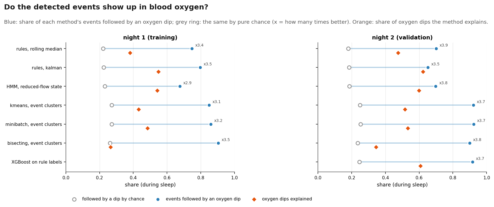

### Number of clusters (k-means, training)


### Run time

Whole night (9.4 h at 256 Hz, 1130 windows): load 1 s, envelope + events 0.5 s, features 6 s on all cores,
transformer + six models under 1 s, plots about 8 s per model (the interactive HTML dominates). Validation
re-uses everything and takes about 1.5 min including plots; `compare` (3 spaces x 6 models x 2 nights) about
4 min.

## Install and run

```bash
conda activate PSNG                      # or any Python >= 3.11 environment
pip install -r requirements.txt

python -m psng all --docs docs           # train on night 1, validate on night 2, report (+ figures into docs/)
python -m psng compare --docs docs       # PCA vs raw vs autoencoder for every model + XGBoost reference
python -m psng sweep --model kmeans --k-min 2 --k-max 12
python -m psng train | validate | report
python -m psng train --no-resume         # ignore caches and refit everything
python -m pytest                         # 41 tests on synthetic breathing and SpO2 signals
```

Run from the repository root. `.vscode/launch.json` has a debug configuration for every command and for the
tests (select the PSNG interpreter).

## Settings (`configs/settings.yaml`)

| section | keys |
|---|---|
| `data` | `channel`, `window_seconds`, `hop_seconds`, `smoothing_seconds`, `normalisation` (`recording` / `window`), `training` and `validation` segments (`file_path`, `start_seconds`, `end_seconds`, optional `hypnogram_path`) |
| `features` | `extractor`, `scale`, `selection` (`none` / `pca` / `correlation`), `reduction` (`pca` / `autoencoder` / `none`, `n_components`, `hidden`, `activation`, `max_iter`) |
| `events` | `apnea_ratio`, `hypopnea_ratio`, `min_seconds`, `max_seconds`, `baseline` (`rolling_median` / `kalman`), `baseline_seconds`, `kalman_process_ratio`, `min_overlap_seconds` |
| `oximetry` | `channel` (`SAT`, `null` disables), `valid_range`, `max_gap_seconds`, `drop_percent`, `lookback_seconds`, `min_seconds`, `lag_seconds` |
| `hmm` | `n_states`, `smoothing_seconds`, `max_iter`, `tol` |
| `models` | `<name>: {constructor args}` for `kmeans`, `minibatch`, `bisecting`, `gmm`, `dbscan`, `isolation` |
| `run` | `output_dir`, `log_dir`, `log_level`, `resume`, `n_jobs`, `chunk_windows`, `interactive_plots`, `plot_max_points` |

Settings are validated with Pydantic at start-up; unknown names fail immediately.

## Outputs

```
outputs/
  cache/features_<stage>_<hash>.csv        window features (hash of data / window / extractor settings)
  training/models/                         feature_transformer.pkl, <model>.pkl (with cluster names), hmm.pkl
  <stage>/events.csv, events.json          rule-based events (+ linked desaturation drop) and the per-night summary (AHI, ODI, confirmed AHI)
  <stage>/desaturations.csv                SpO2 desaturations: start, nadir, end, drop
  <stage>/hmm_events.csv, .json            HMM events and their per-night summary (same columns as the rule events)
  <stage>/csvs/<model>.csv                 one row per window: times, features, event, stage, cluster_id, cluster_label
  <stage>/csvs/<model>_clusters.csv        cluster profile: name, size, event and stage composition, mean features
  <stage>/plots/events.png                 envelope, baselines, events, hypnogram
  <stage>/plots/<model>_timeline.png       cluster per window over the night
  <stage>/plots/<model>.png / .html        PCA scatter / interactive signal coloured by cluster with events and hypnogram
  <stage>/metrics.json                     all metrics per model
  comparison/                              <algorithm>_card.png and <algorithm>_examples.png for rules, every clusterer, HMM and XGBoost;
                                           metrics.png, event_rates.png, tsne.png, spaces.*, supervised.json,
                                           feature_importance.png, baselines.csv, oximetry.csv / .png, oximetry_scores.png, report.md
  spaces/<space>/                          full outputs of the feature-space comparison
docs/figures/                              the figures shown in this README (python -m psng report --docs docs)
```

Features, transformer and models are checkpointed; a re-run resumes from the cache when the settings match.

## Extending

* **Extractor** - subclass `FeatureExtractor`, implement `extract(window) -> dict`, register in `EXTRACTORS`.
* **Clusterer** - subclass `Clusterer`, implement `fit` (set `labels_`, `centers_`) and `predict`, register in `CLUSTERERS`.
* **Reduction** - add a branch in `FeatureTransformer.fit`; anything with `fit` / `transform` works.

## Limits and next steps

* SpO2 confirms events but EEG arousals are not checked, so the confirmed AHI is a lower bound; desaturations
  without a flow event are not yet explained.
* The HMM uses flow only. Adding the SpO2 drop or the thoracic / abdominal belts (`THO`, `ABD`) as further
  observations would let it separate obstructive from central events; an explicit-duration (semi-Markov) model
  would replace the geometric stay times.
* One patient, two nights. The pipeline is per-recording normalised, but cluster names and k were chosen here.
* An autoencoder on the raw 30 s waveform (instead of on the 12 features) is the natural next deep model.
