# PSNG - breathing-event analysis of polysomnography airflow

Unsupervised analysis of the nasal-airflow channel (`DEBIT`) of overnight polysomnography (PSG) recordings.
The goal is to surface breathing events (apnea, hypopnea, artefacts) without hand labels: one night trains,
a second night validates, and every method is scored side by side against a transparent rule-based event
detector, the hypnogram and a supervised reference.

Methods in the box: per-window signal preprocessing, respiratory features, PCA / autoencoder reduction,
six clusterers (k-means, mini-batch k-means, bisecting k-means, Gaussian mixture, DBSCAN, isolation forest),
rule-based event detection with a rolling-median or Kalman baseline, t-SNE visualisation, and XGBoost as a
supervised ceiling. Everything is fitted on night 1 only and applied unchanged to night 2 (no leakage).

## Results at a glance (patient 8, night 1 -> night 2, whole nights)

| | night 1 (training) | night 2 (validation) |
|---|---|---|
| recording / sleep hours | 9.42 / 5.14 | 9.05 / 4.51 |
| rule-based apneas / hypopneas | 2 / 123 | 21 / 157 |
| events per hour of recording / **AHI** (per hour of sleep) | 13.3 / **14.6** | 19.7 / **19.3** |
| best clusterer (k-means, cluster "hypopnea"): event F1 | 0.580 | **0.707** |
| supervised XGBoost on the same features: event F1 / AUC | 0.903 (fit) | 0.731 / 0.937 |

The unsupervised k-means "hypopnea" cluster recovers event windows at F1 0.71 on the unseen night, close to
the 0.73 that a supervised model trained on the detector's labels reaches: the features carry the event
information and the clusters transfer across nights. Both nights land in the moderate sleep-apnea range
(AHI 15-30) by the flow-only rules.

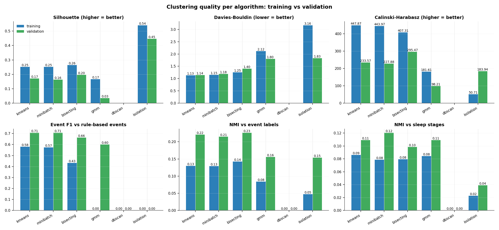

Every cluster gets a descriptive name from its profile, and the same names are reused on the validation night:

| k-means cluster | windows night 1 / 2 | event share night 1 / 2 |
|---|---|---|
| 0: regular breathing | 355 / 396 | 1 % / 2 % |
| 1: irregular rhythm | 119 / 119 | 15 % / 16 % |
| 2: regular breathing #2 | 324 / 101 | 12 % / 16 % |
| **3: hypopnea** | 129 / 214 | **60 % / 68 %** |
| 4: large breaths, mostly W | 203 / 255 | 1 % / 4 % |

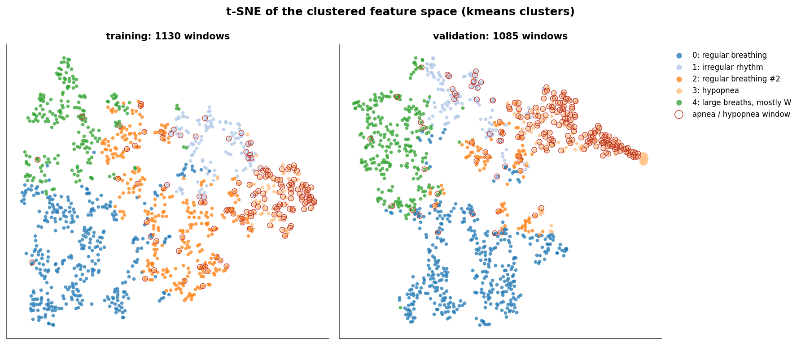

Example windows per cluster, training on the left and validation on the right (window shaded grey, events by
kind). The hypopnea row shows flat stretches in both nights; "large breaths, mostly W" is wake breathing.

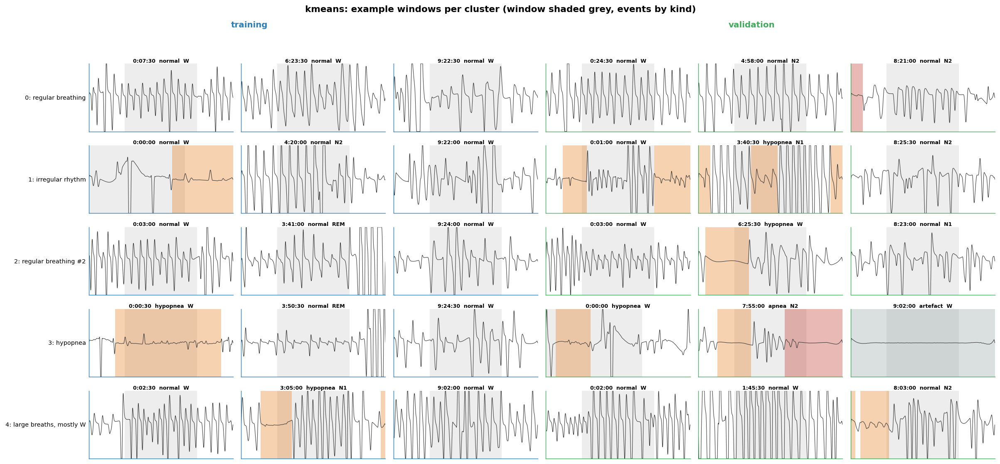

What the detected event kinds look like in each night:

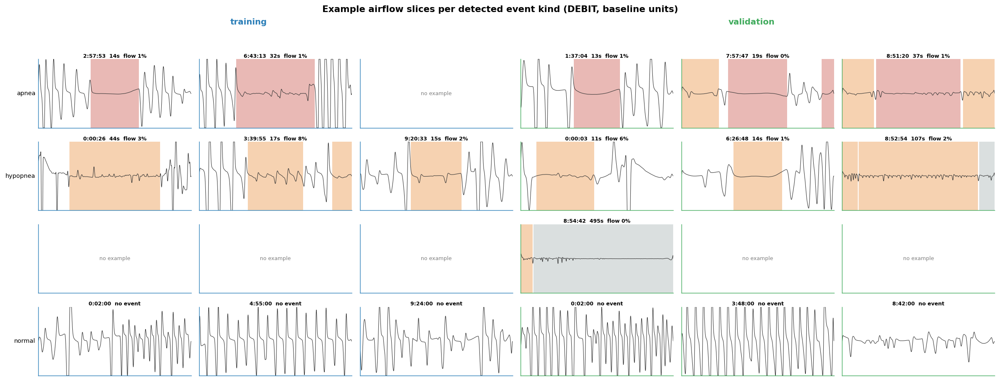

Cluster of every window over the night with events shaded, plus the hypnogram:

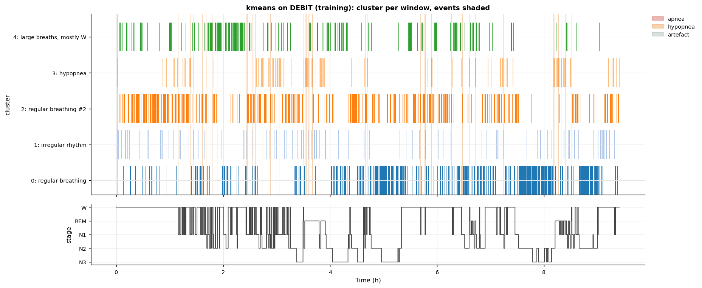
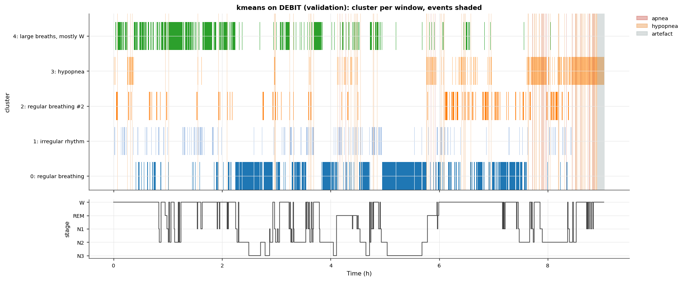

Airflow envelope, the two baseline trackers, detected events and the hypnogram (night 1):

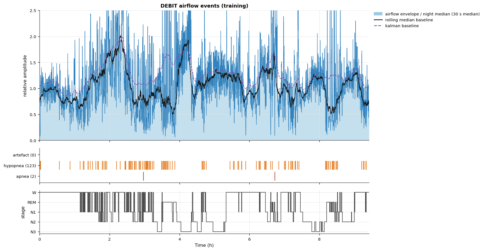

## Pipeline

```
EDF ──► one channel ──► 1 Hz envelope ──► night baseline (median) ──► rule-based events ──► window event labels
             │                                                                                   │
             ▼                                                                             hypnogram (30 s epochs)
       30 s windows ──► smooth · detrend · 0.1-2 Hz band-pass · de-spike · scale by baseline
             ▼
       respiratory features (cached, resumable) ──► z-score ──► select ──► reduce (PCA | autoencoder | none)
             ▼                                                   all fitted on night 1 only, persisted
       clusterers (fitted on night 1) ──► predict night 2 ──► names · profiles · metrics · plots · report
```

Training fits the transformer and the models and names the clusters; validation loads them and only
*applies* them, so validation scores are honest.

## Methods

### Pre-processing (per 30 s window, `psng/windows.py`)

1. **NaN interpolation** - gaps are linearly interpolated.
2. **Smoothing** - 0.5 s moving average removes sensor noise.
3. **Detrend** - a linear trend (DC drift of the flow sensor) is removed.
4. **Band-pass 0.1-2 Hz** - the respiratory band (6-120 breaths/min), 3rd-order Butterworth applied forwards and backwards (zero phase).
5. **De-spike** - 100 ms median filter removes short spikes.
6. **Scaling** - `normalisation: recording` divides by the night's median envelope amplitude, so 1.0 = typical breath and an apnea stays small. `window` z-scores each window on its own (shape only); it was the original behaviour and cannot see amplitude drops, which is why it was replaced.

Filters are designed once per run, not once per window; windows are processed in parallel and the features are
checkpointed in chunks so an interrupted run resumes.

### Features (`psng/features/`)

`respiratory` (default, 12 features per window; the envelope is the RMS per second):

| feature | meaning |
|---|---|
| `amplitude` | median envelope (1.0 = typical breathing of the night) |
| `envelope_min`, `envelope_max`, `envelope_cv` | lowest / highest second and coefficient of variation of the envelope |
| `low_flow_fraction` | share of seconds with flow below 70 % of baseline |
| `apnea_fraction` | share of seconds with flow below 10 % of baseline |
| `longest_low_flow_seconds` | longest run of low flow (the single most informative feature) |
| `breathing_rate`, `breathing_regularity` | breaths per minute from peak detection and the coefficient of variation of the breath intervals |
| `dominant_frequency`, `spectral_entropy` | spectral peak (Hz) and flatness of the spectrum |
| `complexity` | Hjorth complexity (waveform shape) |

Other extractors kept for comparison: `freqtimepatt` (shape + rhythm only), `basic` (amplitude and peak
statistics), `hjorth`, `wavelet` (db4 coefficient statistics).

### Feature transform (`psng/transform.py`)

* **Scaling** - z-score with the training mean and standard deviation.
* **Selection** - `none`, `correlation` (drop one of each pair above a threshold) or `pca` (keep features with strong loadings).
* **Reduction** - `pca` keeps the directions of largest variance (linear); `autoencoder` is a symmetric MLP
  (12 -> 16 -> 3 -> 16 -> 12, tanh) trained to reconstruct its input, the 3 bottleneck activations are the
  reduced features (non-linear); `none` clusters the 12 scaled features directly.

### Clusterers (`psng/clustering/`)

| model | how it works | result here |
|---|---|---|
| `kmeans` | k centroids, each window joins the nearest; 10 restarts | best event F1, stable names across nights |
| `minibatch` | k-means on random batches; same quality, faster on big data | same as k-means |
| `bisecting` | splits the biggest cluster in two until k | higher precision, lower recall |
| `gmm` | k Gaussians with full covariances, soft membership | overlapping components, weak silhouette |
| `dbscan` | clusters = dense regions, the rest is noise | one blob: the feature space is a continuum, not islands |
| `isolation` | DBSCAN clusters plus an isolation-forest "anomaly" cluster | separates outliers, not events |

Unseen windows are assigned by the fitted model (centroids, mixture, nearest core sample); nothing is re-fitted
on validation data. Number of clusters: `python -m psng sweep` scans k (silhouette prefers 2, event F1 peaks at 5
and 10; 5 keeps the clusters interpretable).

### Rule-based event detection (`psng/events.py`)

On the 1 Hz envelope relative to a **local baseline**: apnea = flow below 10 % for >= 10 s, hypopnea = below
70 % for >= 10 s, artefact = low flow for more than 120 s (sensor off). These follow the AASM flow criteria but
cannot check desaturation or arousal, so they are a reference for the clusters, not a diagnosis. The baseline
is either a centred **10-minute rolling median** or a **Kalman smoother** (local-level model, forward filter +
backward RTS pass, `psng/kalman.py`); the Kalman level is slower to follow amplitude drops, so it flags about
50 % more events (see the table below). AHI = apneas + hypopneas starting in sleep per hour of sleep, using the
hypnogram.

### Post-processing

* **Window labels** - each window takes the event kind it overlaps for >= 5 s (apnea > hypopnea > artefact), and the sleep stage of its epoch.
* **Cluster profiles and names** - per cluster: size, event composition, stage composition, mean features. Names follow the profile (majority event kind, else airflow amplitude / rate / regularity, plus the dominant stage); they are stored with the model so validation reuses them.
* **Scores** - internal: silhouette, Calinski-Harabasz, Davies-Bouldin. External: event F1 / precision / recall (clusters whose majority is an event act as the detector), NMI against event labels and against sleep stages.
* **t-SNE** - visualisation only (it cannot project unseen windows); each night is embedded separately.
* **XGBoost reference** - trained on night-1 windows with the rule labels, tested on night 2; gives the ceiling the features allow and the feature importances.

XGBoost applied to night 2: predicted event probability per window with the rule-based event windows marked,
and the ROC curve. Most misses are short hypopneas in windows that also hold normal breaths.

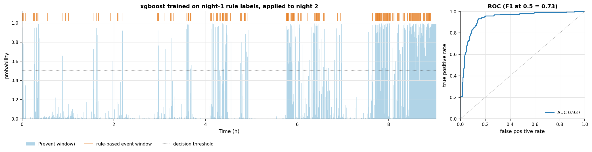
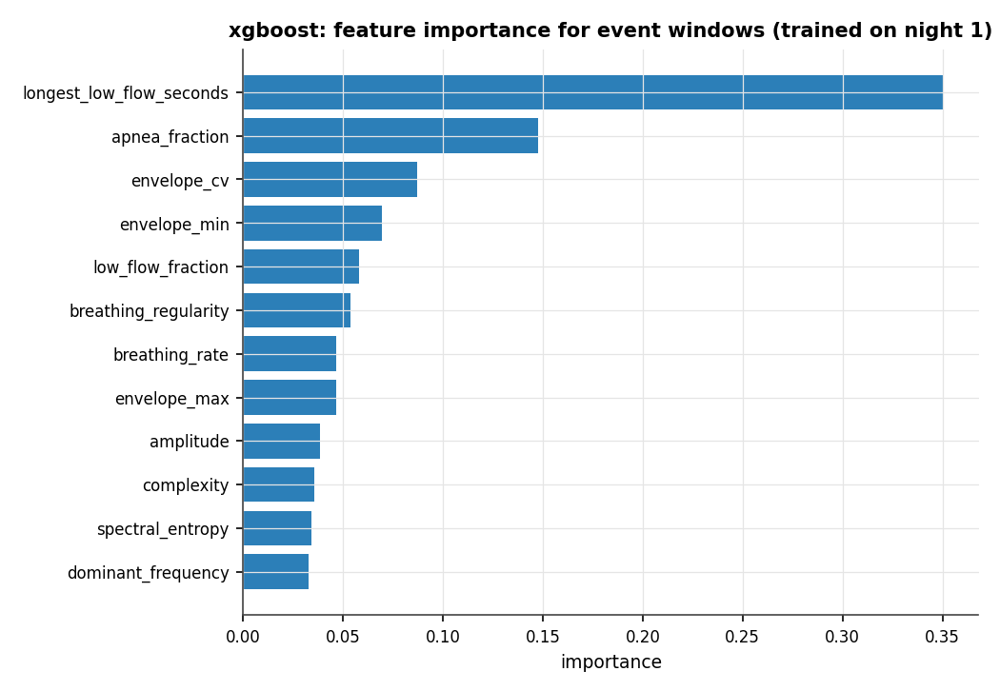

Kalman versus rolling-median baseline on the busiest hour of night 2. Both trackers agree on the events here;
over a whole night the Kalman level reacts more slowly to amplitude drops, so it flags more hypopneas.

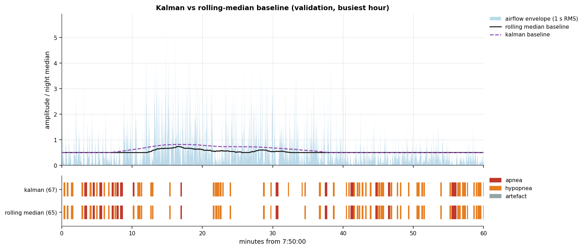

PCA versus autoencoder bottleneck, coloured by the rule-based event kind. Events spread along PC1 (amplitude /
low-flow direction) in both nights; the autoencoder folds them into a curved band that k-means separates less
cleanly, which matches its lower event F1.

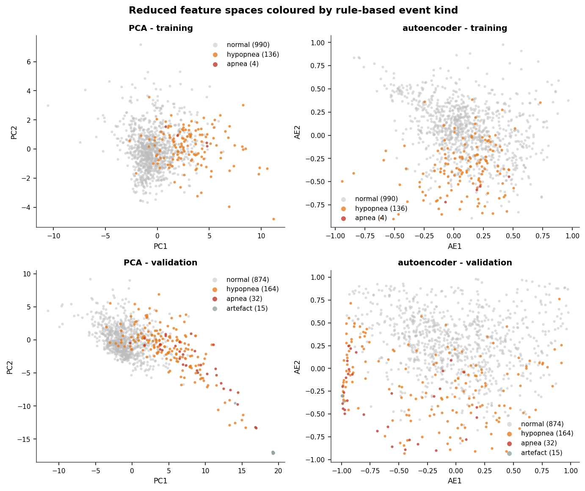

### Leakage guards

Scaler, selection, PCA / autoencoder, clusterers, cluster names and the classifier are fitted on night 1 only.
Night 2 uses its own envelope baseline (sensor gain differs between nights) but is otherwise only transformed and
predicted. The two-sided baseline (rolling median / RTS smoother) looks into the future within a night, which is
fine for offline scoring but would need the causal Kalman filter for on-line use.

## Metrics

### Clusterers, training and validation (best per column and stage in bold)

| algorithm | stage | n_clusters | n_noise | silhouette | davies_bouldin | calinski_harabasz | event_f1 | event_precision | event_recall | event_nmi | stage_nmi |
|---|---|---|---|---|---|---|---|---|---|---|---|
| kmeans | training | 5 | 0 | 0.252 | **1.133** | **447.9** | **0.580** | 0.605 | 0.557 | 0.130 | **0.086** |
| minibatch | training | 5 | 0 | 0.251 | 1.147 | 444.0 | 0.573 | 0.576 | **0.571** | 0.129 | 0.079 |
| bisecting | training | 5 | 0 | 0.265 | 1.250 | 407.3 | 0.433 | **0.778** | 0.300 | **0.143** | 0.079 |
| gmm | training | 5 | 0 | 0.166 | 2.120 | 181.6 | 0.000 | 0.000 | 0.000 | 0.084 | 0.084 |
| dbscan | training | 1 | 137 | - | - | - | 0.000 | 0.000 | 0.000 | 0.000 | 0.000 |
| isolation | training | 2 | 81 | **0.540** | 3.163 | 50.7 | 0.000 | 0.000 | 0.000 | 0.047 | 0.023 |
| kmeans | validation | 5 | 0 | 0.171 | **1.138** | 233.6 | **0.707** | 0.678 | 0.740 | 0.221 | 0.109 |
| minibatch | validation | 5 | 0 | 0.163 | 1.183 | 227.9 | 0.707 | 0.668 | **0.750** | 0.215 | **0.120** |
| bisecting | validation | 5 | 0 | 0.197 | 1.401 | **295.5** | 0.663 | **0.753** | 0.592 | **0.226** | 0.098 |
| gmm | validation | 5 | 0 | 0.034 | 1.800 | 98.2 | 0.601 | 0.527 | 0.699 | 0.156 | 0.109 |
| dbscan | validation | 1 | 394 | - | - | - | 0.000 | 0.000 | 0.000 | 0.000 | 0.000 |
| isolation | validation | 2 | 149 | **0.446** | 1.829 | 183.9 | 0.000 | 0.000 | 0.000 | 0.153 | 0.039 |

Silhouette is modest for every model because breathing varies continuously; the isolation forest scores highest
on silhouette only because it isolates a small outlier group. Event F1 and NMI are the metrics that matter for
the goal.

### Feature spaces side by side (validation event F1)

| algorithm | autoencoder3 | pca3 | raw |
|---|---|---|---|
| bisecting | 0.477 | 0.663 | 0.674 |
| dbscan | 0.000 | 0.000 | 0.000 |
| gmm | 0.000 | 0.601 | 0.652 |
| isolation | 0.000 | 0.000 | 0.565 |
| kmeans | **0.620** | **0.707** | **0.708** |
| minibatch | 0.603 | 0.707 | 0.631 |

PCA (3 components) and the raw 12 features tie for k-means; PCA keeps the clusters tighter (silhouette 0.17 vs
0.07) so it stays the default. The autoencoder bottleneck is worse on this small data set. Full table:
`outputs/comparison/spaces.md`.

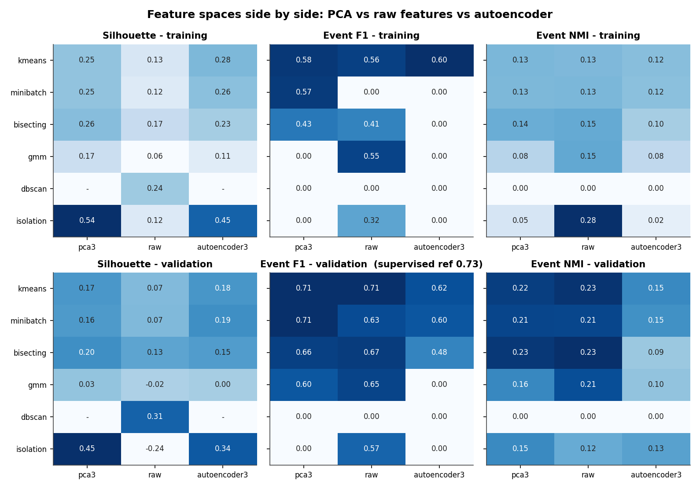

### Supervised reference and baseline trackers

| model | train F1 | validation F1 | precision | recall | AUC |
|---|---|---|---|---|---|
| XGBoost (300 trees, depth 3) on rule labels | 0.903 | **0.731** | 0.675 | 0.796 | 0.937 |

Top features: longest_low_flow_seconds (0.35), apnea_fraction (0.15), envelope_cv (0.09), envelope_min (0.07).

| stage | baseline | apnea | hypopnea | artefact | events / h | AHI |
|---|---|---|---|---|---|---|
| training | rolling median | 2 | 123 | 0 | 13.3 | 14.6 |
| training | Kalman | 11 | 186 | 0 | 20.9 | 22.9 |
| validation | rolling median | 21 | 157 | 1 | 19.7 | 19.3 |
| validation | Kalman | 30 | 220 | 1 | 27.6 | 28.6 |

### Number of clusters (k-means, training)

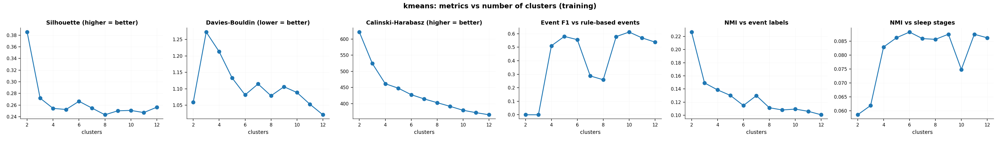

### Run time

Whole night (9.4 h at 256 Hz, 1130 windows): load 1 s, envelope + events 0.5 s, features 6 s on all cores,
transformer + six models under 1 s, plots about 8 s per model (the interactive HTML dominates). Validation
re-uses everything and takes about 1.5 min including plots; `compare` (3 spaces x 6 models x 2 nights) about
4 min.

## Install and run

```bash
conda activate PSNG                      # or any Python >= 3.11 environment
pip install -r requirements.txt

python -m psng all --docs docs           # train on night 1, validate on night 2, report (+ figures into docs/)
python -m psng compare --docs docs       # PCA vs raw vs autoencoder for every model + XGBoost reference
python -m psng sweep --model kmeans --k-min 2 --k-max 12
python -m psng train | validate | report
python -m psng train --no-resume         # ignore caches and refit everything
python -m pytest                         # 33 tests on synthetic breathing signals
```

Run from the repository root. `.vscode/launch.json` has a debug configuration for every command and for the
tests (select the PSNG interpreter).

## Settings (`configs/settings.yaml`)

| section | keys |
|---|---|
| `data` | `channel`, `window_seconds`, `hop_seconds`, `smoothing_seconds`, `normalisation` (`recording` / `window`), `training` and `validation` segments (`file_path`, `start_seconds`, `end_seconds`, optional `hypnogram_path`) |
| `features` | `extractor`, `scale`, `selection` (`none` / `pca` / `correlation`), `reduction` (`pca` / `autoencoder` / `none`, `n_components`, `hidden`, `activation`, `max_iter`) |
| `events` | `apnea_ratio`, `hypopnea_ratio`, `min_seconds`, `max_seconds`, `baseline` (`rolling_median` / `kalman`), `baseline_seconds`, `kalman_process_ratio`, `min_overlap_seconds` |
| `models` | `<name>: {constructor args}` for `kmeans`, `minibatch`, `bisecting`, `gmm`, `dbscan`, `isolation` |
| `run` | `output_dir`, `log_dir`, `log_level`, `resume`, `n_jobs`, `chunk_windows`, `interactive_plots`, `plot_max_points` |

Settings are validated with Pydantic at start-up; unknown names fail immediately.

## Outputs

```
outputs/
  cache/features_<stage>_<hash>.csv        window features (hash of data / window / extractor settings)
  training/models/                         feature_transformer.pkl and <model>.pkl (with cluster names)
  <stage>/events.csv, events.json          rule-based events and the per-night summary (AHI, counts)
  <stage>/csvs/<model>.csv                 one row per window: times, features, event, stage, cluster_id, cluster_label
  <stage>/csvs/<model>_clusters.csv        cluster profile: name, size, event and stage composition, mean features
  <stage>/plots/events.png                 envelope, baselines, events, hypnogram
  <stage>/plots/<model>_timeline.png       cluster per window over the night
  <stage>/plots/<model>.png / .html        PCA scatter / interactive signal coloured by cluster with events and hypnogram
  <stage>/metrics.json                     all metrics per model
  comparison/                              metrics.png, event_rates.png, tsne.png, *_examples.png, spaces.*, supervised.json,
                                           feature_importance.png, baselines.csv, report.md
  spaces/<space>/                          full outputs of the feature-space comparison
docs/figures/                              the figures shown in this README (python -m psng report --docs docs)
```

Features, transformer and models are checkpointed; a re-run resumes from the cache when the settings match.

## Extending

* **Extractor** - subclass `FeatureExtractor`, implement `extract(window) -> dict`, register in `EXTRACTORS`.
* **Clusterer** - subclass `Clusterer`, implement `fit` (set `labels_`, `centers_`) and `predict`, register in `CLUSTERERS`.
* **Reduction** - add a branch in `FeatureTransformer.fit`; anything with `fit` / `transform` works.

## Limits and next steps

* The event reference is flow-only; confirming hypopneas needs the SpO2 (`SAT`) desaturation or EEG arousals.
* One patient, two nights. The pipeline is per-recording normalised, but cluster names and k were chosen here.
* An autoencoder on the raw 30 s waveform (instead of on the 12 features) is the natural next deep model.
